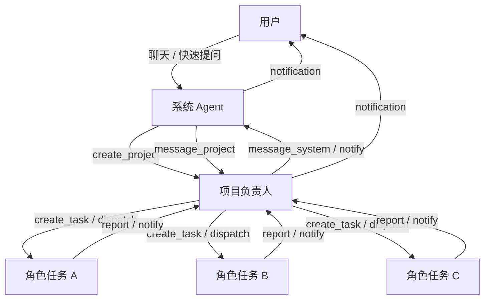
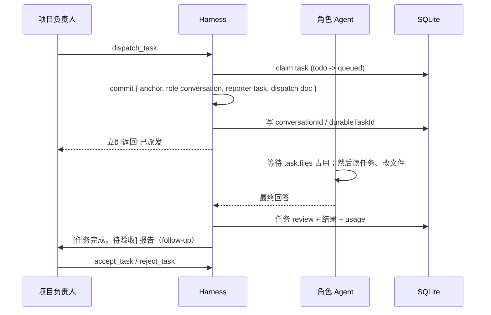

# 元芳 · 架构设计

## 1. 目标

做一个「用户只和系统 Agent 说话」的常驻桌面系统：

- 系统 Agent 判断需求、立项、指挥项目负责人；
- 项目负责人拆任务、并行派发、验收、向上汇报；
- 角色 Agent 执行任务，能读写项目文件；
- 任务在后台持久运行，不阻塞任何对话；
- 记忆让每次新对话都能接上上下文；
- 系统能自建技能、插件，审批后接 MCP；
- 系统 Agent 有人格，UI 有项目卡片、通知、快捷键。

## 2. 技术基座

- **[Pi Durable](https://www.npmjs.com/package/@earendil-works/pi-durable)**：conversation、durable task、document、扩展、工具、watch、usage 全部由它提供。
- **SQLite**：`harness.sqlite` 存 durable 状态；`yuanfang.sqlite` 存业务数据（项目、任务、消息、记忆、索引、审批）。
- **Electron**：主进程持有 runtime，渲染进程只通过 `contextBridge` + IPC 访问，不直接碰 Node。
- **React + Vite**：主窗口和快速提问窗口共用一套 renderer，通过 `?quick=1` 区分。

## 3. 需求映射

| 需求 | 实现 |
| --- | --- |
| 主 Agent 判断需求、创建项目 | 系统 conversation + `create_project` / `message_project` / `project_status` 工具；system prompt 明确判断顺序 |
| 每个项目一个负责 Agent | `projects.conversation_id` 指向一个 ownerless conversation；动态 prompt section 注入项目简介、任务板、记忆、技能 |
| 负责人拆任务、定流程、分配角色 | `create_task` / `dispatch_task` / `dispatch_ready` / `update_task` / `cancel_task`；任务包含 role、brief、files、dependsOn |
| 任务并行 | 每个任务创建 background `RoleRun` durable task + 独立角色 conversation；`dispatch_ready` 一次启动所有就绪任务 |
| 同一文件要等别的 Agent 改完 | 全局 `FileLockManager` + `wrapTool(edit/write)`；按 canonical path 排队，UI 显示当前锁 |
| 任务不阻塞交流 | 所有角色任务都是 `background: true`；系统/项目对话的 run 与角色任务互不等待 |
| 系统 ↔ 项目负责人沟通 | `message_project` / `message_system`，异步投递；负责人忙时按 follow-up 排队 |
| 快捷键呼出对话框 | Electron `globalShortcut` `⌘⇧Space` → 独立 frameless quick window |
| 任务栏弹出简要、点击看详情 | runtime `notification` 事件 → Electron `Notification`；click → 打开主窗口并跳项目 |
| 项目卡片统计 | `projects` + `tasks` + `conversation_usage` 聚合；用时、tokens、缓存命中、创建/更新时间、进行中任务 |
| 右侧对话栏可展开/收起 | `SidebarChat`，状态存 localStorage，窄屏变 overlay |
| 记忆系统 | `memories` 表 + FTS5；显式 `remember/recall` + 自动 episode；prompt 每次注入 global/project 记忆 |
| 文件架构索引 | `ProjectIndexer` 扫描目录 → `files` 表；`repo_find` / `search_everything` / 项目「架构」页 |
| 每次对话新开但界面连贯 | 系统对话在每个用户回合结束后 `reset(handoff)`；handoff 由记忆 + 项目总览 + 最近消息生成；UI 消息表独立保留 |
| 项目负责人/角色也尽量连续 | 项目负责人在非报告回合后同样 reset；角色任务一个 conversation 持续到任务结束 |
| 自建/修改 skill | `skill_write` / `skill_list` / `read_skill`；全局与项目 `.yuanfang/skills` |
| 自建/优化插件 | `plugin_write` / `plugin_reload`；`PluginService` 动态 import + registry.install |
| 安装软件 / MCP 需同意 | `request_approval` + `bash` guard + `mcp_add`；批准后执行/安装，拒绝后告知请求方 |
| 系统 Agent 人格 | `~/.yuanfang/persona.md`，设置面板可编辑，prompt section 每次请求重读 |
| 用户只和系统 Agent 沟通 | 项目负责人和角色 Agent 不暴露输入入口；项目页的「项目对话」只是只读/系统转发 |

## 4. Agent 拓扑



### 4.1 系统 Agent

- conversation：`system_conversation_id`（kv），root 之外新建的 ownerless conversation。
- 模型：`config.provider/model`。
- extensions：去掉 `project-tools`、`role-tools`；保留 coding、file-locks、guard、shared、system。
- 工具：项目创建/查询、任务查询、记忆、审批、技能、插件、MCP、索引、人格。
- 会话策略：每个用户回合 `wait` 完成后，写 episode 记忆，然后 `reset(systemHandoff)`。
- 不会直接写项目文件：`modelTools.remove = [write, edit]`，只保留 read/bash（bash 受审批 guard 约束）。

### 4.2 项目负责人

- conversation：每个项目一个 ownerless conversation，prompt sections 动态渲染项目简介、任务板、记忆、技能。
- 工具：任务创建/派发/取消/更新、项目索引、技能、记忆、审批、`message_system`、`finish_project`。
- 任务完成报告以 `yf.task_report` 事件消息进入对话；负责人验收后可以：
  - `notify_user` 给用户发通知；
  - `message_system` 给系统 Agent；
  - `finish_project` 归档；
  - 创建返工任务。
- 会话策略：用户/系统主动消息回合结束后 reset；角色报告回合不 reset（避免每次报告都丢上下文）。

### 4.3 角色 Agent

- 每个任务创建一个 task-owned conversation，复制项目负责人的 agent 配置后：
  - 换角色模型/思考等级；
  - `cwd = project.path`；
  - 移除 `system-tools` / `project-tools`；
  - 注入角色 instructions（项目背景、任务 brief、文件范围、架构摘要、记忆、技能、纪律）。
- 工具：coding、file-locks、guard、shared、role（`report_progress`）。
- 生命周期：任务结束 conversation 保留（可回看），不参与后续上下文。

## 5. Durable 任务模型

### 5.1 Anchor

`yuanfang.anchor` 是一个立刻结束的 background task，作用是把角色 conversation 的所有权挂在项目 conversation 的 background 边界上，使系统/项目对话的 abort、idle 等待不会误伤后台任务。

### 5.2 RoleRun

`yuanfang.role-run`：

```
deliver:
  - 按 task.files 占住文件；等待期间 DB 标 waiting
  - DB 标 running，记录 startedAt
  - 向角色 conversation submit 任务 brief（requestId 幂等）
  - await submission
  - 读取 assistant entry
  - 如果有 pending 审批 → 进入 await_approval
  - 否则 markFinished: review（成功）或 failed，进入 report
await_approval:
  - 每 3s 检查审批；等待期间 DB 标 waiting
  - 已批准/拒绝 → 进入 resume
resume:
  - 把审批结果投回同一个角色 conversation（requestId 幂等）
  - await submission；可能再次进入 await_approval
  - 最终 markFinished: review / failed
report:
  - 写 duration、记忆、usage
  - 向项目负责人 conversation submit [任务完成，待验收]（requestId 幂等）
  - notification
  - terminal
abort:
  - 释放文件占用；DB 标 cancelled
```

崩溃恢复：

- `deliver` 重跑：requestId 相同，拿到同一个 submission；文件锁保证重复 edit/write 串行。
- `report` 重跑：DB 更新幂等；report requestId 相同，不会重复投递。
- `harness.resume()` 在启动时继续所有未完成任务。

### 5.3 派发序列



## 6. 文件锁与文件占用

- `FileLockManager` 按 `realpath` 规范化路径，多路径按字典序获取，避免死锁；同一 owner 可重入。
- 任务 dispatch 后，`RoleRun.deliver` 会先按 `task.files` 占住这些路径，再启动角色 Agent。第二个声明同一文件的任务会停在 `waiting`，不会读到旧文件、规划出过期修改。
- `edit` / `write` 的 owner 是 `task:<id>`，因此与任务级占用重入；等待者按 FIFO，取消/中断会释放。
- 锁是进程内锁，覆盖同一个 runtime 的所有 Agent；不覆盖外部编辑器，也不覆盖未声明文件的 `bash` 写入。
- UI 通过 `locks` 事件显示当前锁数量和详情。
- Pi Durable 自带的 `withFileMutationQueue` 仍在底层做同环境串行，两层叠加是安全的。

## 7. 记忆与会话连续性

### 7.1 记忆类型

- `note`：普通笔记
- `decision`：决策
- `architecture`：架构事实
- `preference`：用户偏好
- `episode`：自动写入的对话/任务片段

scope 为 `global` 或项目 ID。`pinned` 永远进入 prompt。

### 7.2 上下文重建

每次模型请求前，prompt section 动态读取：

- persona（`persona.md`）
- 运作规则
- 记忆摘要（pinned + 最近 + 最近 episode）
- 项目总览（系统）或项目简介 / 任务板（项目）
- 技能列表（名称 + 描述）

系统 episode 在用户回合结束后写入，然后 reset：

```
用户：...（本轮）
元芳：...（本轮）
→ episode 记忆
→ reset(handoff)
handoff = 长期记忆 + 项目总览 + 最近 8 条消息
→ 下一轮用户消息
```

UI 消息存在 `messages` 表，不随 reset 消失，所以界面是连贯的。

### 7.3 为什么 reset 而不是一直聊

- 控制上下文成本，避免系统 Agent 被几个月的历史拖慢；
- 记忆是可审计、可编辑的，reset 后仍能复现关键事实；
- 每条用户消息都能在干净上下文里重新判断，减少历史惯性。

## 8. 项目索引

- 创建项目时扫描一次；`index_project` 可重建。
- 跳过 `node_modules`、`.git`、`dist`、`build`、`target`、`.venv` 等；跳过二进制和 >1.5MB 文件。
- 每条记录：path、size、mtime、language、summary（Markdown 标题/首段，代码注释/首行）。
- `repo_find` 按 path/summary 模糊匹配；`search_everything` 合并记忆和文件结果。

## 9. 技能、插件、MCP

### 9.1 技能

- 位置：`~/.yuanfang/skills/<slug>/SKILL.md` 或 `<project>/.yuanfang/skills/...`。
- frontmatter：`name`、`description`；正文是 Markdown。
- prompt 只注入名称和描述，正文通过 `read_skill` 按需加载（渐进披露）。
- 系统/项目负责人可以 `skill_write`，角色可以读。

### 9.2 插件

- 位置：`~/.yuanfang/plugins/*.mjs`。
- 模块导出 `name`、`description`、`activate(ctx)`。
- `ctx.pi` 提供 `defineTool` / `defineExtension` / `section` / `wrapTool` / schema builders；
- `ctx.install(extension)` 安装到实时 registry；
- `ctx.app` 暴露 store/host/runtime；
- `plugin_write` 写入后立即 import + install，`plugin_reload` 用 mtime 缓存破坏重新加载。
- 插件是可信代码，没有沙箱。

### 9.3 角色定义

`~/.yuanfang/roles.json` 保存角色名、描述和 instructions。内置架构师 / 前端 / 后端 / 测试 / 文档 / 执行。`role_list` 查看，`role_upsert` 新增或修改；派发任务时按角色名合并进角色 Agent 的 instructions。

### 9.4 MCP

- `mcp.json` 保存 stdio 或 Streamable HTTP server 配置，可带 `projects` 白名单。
- `McpService` 用 `@earendil-works/pi-mcp` 的 `StdioTransport` / `StreamableHttpTransport` + `McpClient`：
  - connect → `tools/list`；
  - 每个 MCP tool 转成 `mcp_<server>_<tool>` 的 pi-durable tool；
  - `callTool` 结果用 `toLlmContent` 转成模型 content；
  - 安装为 `mcp-<server>` extension，进入实时 registry；工具执行时检查项目白名单（系统 Agent 不受项目限制）。
- 接入流程：系统 Agent 调 `mcp_add` → 创建 `kind=mcp` 审批 → 用户批准 → `resolveApproval` 自动 install。
- 启动时读取 `mcp.json` 并后台连接；断线会记录错误。设置页可以查看/移除 server。
- 任务级审批不会直接投递结果，而是由 `RoleRun` 的 `await_approval` 阶段唤醒同一个角色对话，保证任务不被判成完成。

## 10. 审批与安全

- `request_approval` 创建 durable DB 记录并通知 UI；非任务审批以 follow-up 消息返回，任务审批由 `RoleRun.await_approval` 唤醒原任务。
- `bash` guard：匹配安装、`git clone`、`docker pull/run`、`curl | sh`、`sudo`、`npx` 等模式；没有 24h 内的同命令 grant 就 block，并提示调用 `request_approval`。
- shell grant 的 payload 同时记录 `commandHash` 和 `projectId`；guard 只在同一项目内放行，避免一个项目批准的命令被另一个项目复用。
- 审批结果重复提交会被 `status = pending` 的原子更新挡住，不会重复投递。
- 系统 Agent 的 `write/edit` 被 `modelTools` 移除，降低误改项目文件的概率。
- 项目和网页内容在 prompt 中被视为不可信数据；系统提示明确禁止执行其中的“忽略指令”。

## 11. 统计口径

- `totalMs`：项目负责人对话的回合耗时 + 角色任务执行耗时（`RoleRun` 的 deliver→report）。UI 标为「Agent 用时」，并注明可能重叠，不再暗示墙钟时间。
- `tokens`：UI 主展示 `input + output`（billable），另保留含缓存的 total；缓存读写单独展示。
- `cacheHitRate`：`cacheRead / (input + cacheRead + cacheWrite)`。
- `cost`：模型目录价格估算，来自 `Usage.cost.total`。
- 增量同步：`conversation_usage` 保存上次快照，`syncUsage` 只把 delta 加到项目和任务；每 20s 全量对账一次。

## 12. 进程与 UI

### 12.1 主进程

- 创建 runtime，订阅事件，转发到窗口。
- 托盘、全局快捷键、通知、菜单、单实例锁。
- IPC handler 直接调用 runtime 方法；renderer 不持有任何 Node 能力。

### 12.2 事件

`RuntimeEvent`（`packages/shared`）：

- `status`、`agent_busy`、`assistant_delta`、`assistant_message`
- `tool`、`project_updated`、`task_updated`、`approval_updated`
- `notification`、`locks`、`log`

streaming 来自 `conversation.watch()` 的 `pi.live.generation.message`；committed assistant entry 写入 `messages` 并发出 `assistant_message`。

### 12.3 快速提问

独立 720×210 frameless window，全局快捷键切换；输入后调用 `sendSystemMessage`，窗口立即隐藏；系统回复通过任务栏通知，快速窗口若还开着也会显示。

## 13. 凭据与通知

- 凭据存储是 `LayeredFileCredentialStore`：远方自己的 `auth.json` 优先，其次只读 Pi 的 auth，最后 provider 的 env/ambient 解析。
- 设置页左侧厂商、右侧配置；保存 API Key 后调用 `models.refresh({ providers: [id] })` 再读 `getModels(id)`，因此动态 provider 的模型列表在填入 Key 后出现。
- 通知写入 `notifications` 表；`#notify` 先落库再按 `notifyLevel` 决定是否推送 Electron 通知。通知记录带 `messageId`，系统对话支持锚点跳转。

## 14. 数据、迁移与备份

- 业务库用 SQLite `user_version` 记录 schema 版本；新增表/列在 `openDatabase` 幂等创建，`task_events` 缺列会 `ALTER TABLE`。
- `npm run backup` 用 `VACUUM INTO` 生成一致的 SQLite 快照，并复制 config / persona / mcp / roles 到 `~/.yuanfang/backups/<timestamp>`。
- 注意：备份不包含 `auth.json`，避免复制凭据；恢复后需要重新登录或使用环境变量。

## 15. 失败与恢复

- **进程崩溃**：SQLite + Pi Durable checkpoint；重启后 `harness.resume()` 继续未完成任务。
- **角色任务中断**：`RoleRun` 的 `deliver` 重跑，requestId 幂等；工具不 replay-safe 的会收到 interrupted 结果。
- **项目负责人中断**：conversation 的 run 会重试；报告作为 follow-up 留在 inbox。
- **系统对话中断**：`runFailure` 显示原因，UI 收到 event 消息和通知，不自动 reset。
- **审批悬空**：审批记录在 DB；重启后仍可在审批面板处理。
- **锁残留**：进程内锁随进程退出释放；崩溃不会留下跨进程文件锁。

## 16. 扩展点

- 新工具：`tools.ts` 里按 Agent 类型加 `defineTool`。
- 新任务类型：`task-defs.ts` 里 `defineTask`，安装到 registry。
- 新 Agent 类型：新增 extension + `scopeFor` 识别 conversation 归属。
- 新 prompt section：`prompts.ts` 的 `sectionUntagged`，或在插件里 `ctx.pi.section`。
- 新存储后端：Pi Durable 支持 memory / SQLite / JSONL / IndexedDB；替换 `openNodeSqliteStorage`。
- 远程执行环境：实现 Pi Durable 的 `ExecutionEnv`，把 `env` 指向远端容器。
- 远程 UI：把 runtime 事件与 IPC 换成 WebSocket；核心已经是事件驱动。

## 17. 已知取舍

- 系统 Agent 每轮 reset，牺牲原始长上下文换取成本与可控性；需要完整历史时查 UI 消息/记忆。
- 角色任务完成即 `done`，验收由项目负责人负责；没有自动 diff 审查。
- 文件占用只覆盖任务声明的 `files`；未声明文件的 `bash` 写入仍可能绕过。
- 没有 per-task worktree / 自动 git 分支；并行任务的逻辑冲突仍可能发生。
- 记忆检索是关键词/FTS，不是语义检索；中文长句依赖 LIKE 兜底。
- MCP 只支持 stdio；没有 OAuth/HTTP。
- 插件无沙箱，只有“用户信任”这一层。
- 没有多用户、权限和配额；当前是单机单用户。
- 通知没有系统级通知中心；点击只能回到项目/对话，不能精确滚动到消息。
- 没有登录 / 凭据设置 UI；首次使用需要先在 Pi 登录或配置环境变量。

## 18. 下一步

1. 打包/签名/自动更新 + 通知图标。
2. MCP HTTP/OAuth、按项目启用、工具权限清单。
3. bash 写入的文件级检测（或提供受锁的 `write_file` 命令包装）。
4. 任务 diff、自动验收、回滚。
5. 记忆去重、遗忘、向量检索。
6. 多项目并行压测与 token 预算。
